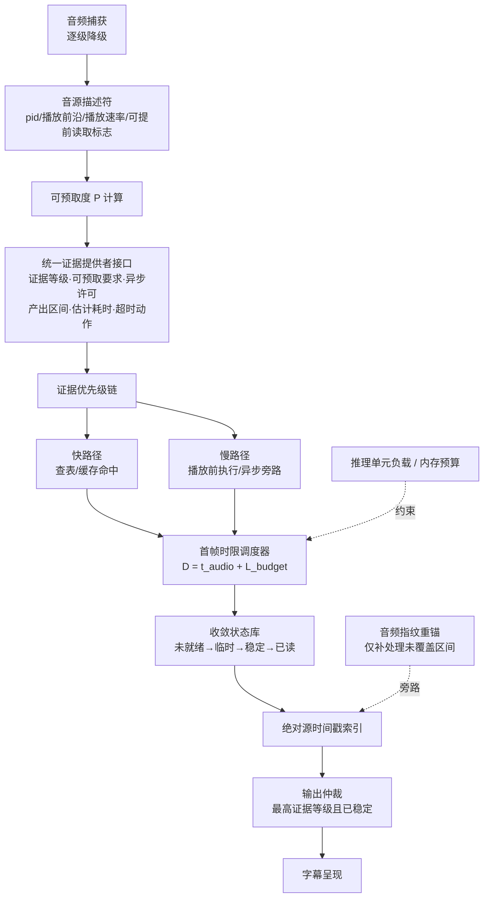
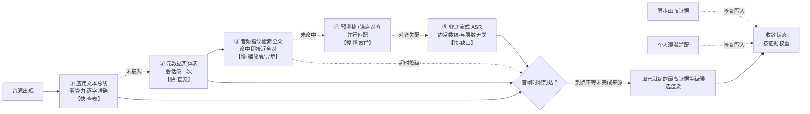
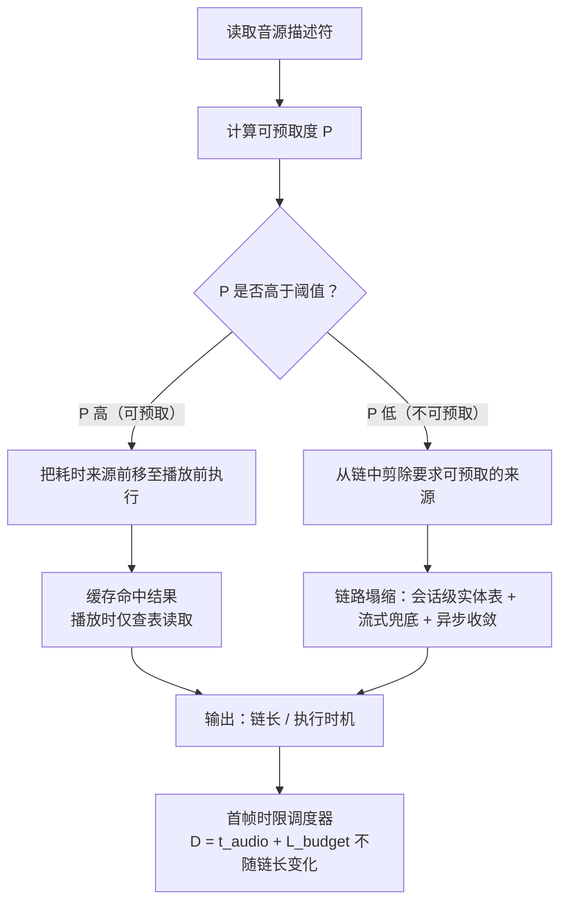
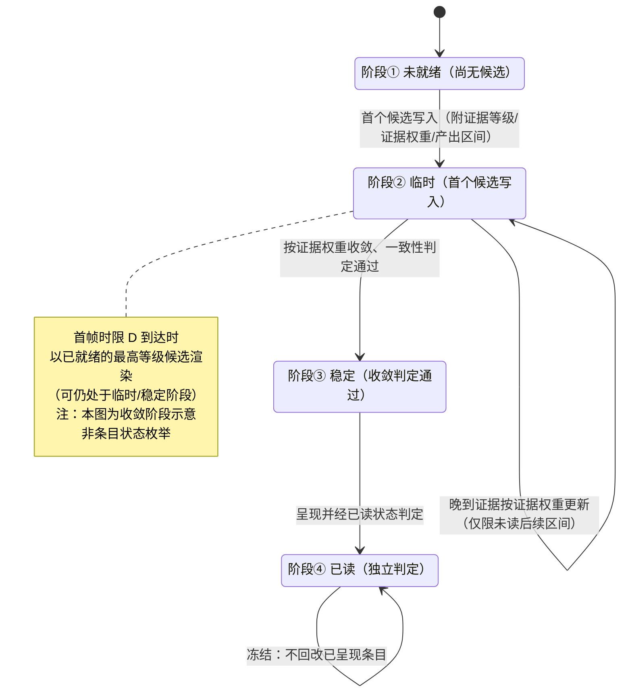
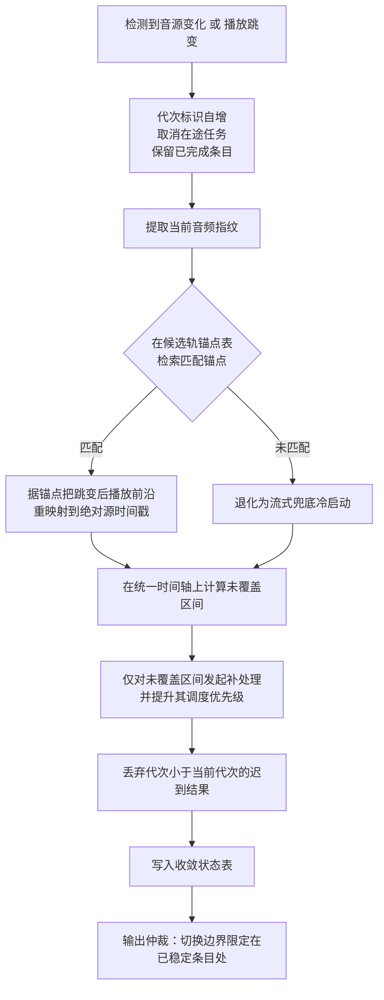
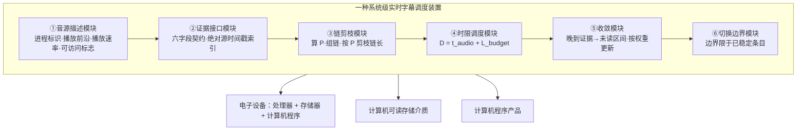

# 04 · 说明书摘要、摘要附图、说明书附图、请求书要素与形式规范

> **状态：技术草稿，需专利代理师复核，不构成任何法律结论。** 本文为申请文件分片，不可直接提交；全部判断须由具备资质的专利代理师复核、改写并出具意见。
> **所属申请（发明名称）**：一种基于证据优先级链的系统级实时字幕调度方法及装置。
> **本分片范围**：说明书摘要、摘要附图、说明书附图（文字化，图 1–图 8）、请求书要素清单、形式规范核对表、提交前事项清单、校验记录。
> **跨分片一致性**：图号与图题以本分片图 1–图 8 清单为准，说明书附图说明须与此逐字一致。02 分片（权利要求书）、03 分片（说明书）的术语与附图标记须与本文术语表对齐；01 分片为现有技术检索与区别特征论证，05 分片为客体适格性基线。
> **数值口径**：本文（摘要与附图说明）出现的参数取值与性能表述均为机理推导或说明性示例，不得写成已获得的实验结果。本机实测数据另见 `07-measurement/RESULTS.md`（G1–G5、CER 六组）。说明书 §3.5 仅引用其中 G1/G2/G3/G5：G1–G3 为真实管线实测（素材为本机语音合成生成的语音，非真人录音），G5 的 P 抖动为受控注入；**G4（参数注入的算术验证）与 CER（识别准确率）均未写入说明书**。摘要不引用任何实测数值。
> **披露风险**：申请前不得把 `docs/` 下技术草稿推送到公开仓库，详见第六节。

---

## 一、说明书摘要

### 摘要正文

<!-- ABSTRACT-START -->
一种基于证据优先级链的系统级实时字幕调度方法及装置。各来源经统一接口声明证据等级、可预取性要求、产出区间、估计耗时与超时动作，候选按绝对源时间戳索引；由音源描述符算可预取度P，P经修正耗时进入反解：按首帧时限预算逐位累加修正耗时，取不超预算的最大序位数为链长k，超出者不执行且不留缓冲；为每一时间区间维护充分性证书，覆盖率与最高等级达标且k内来源已终结时成立，成立则低等级来源不推理，k变则重判、等级变则重算k，迭代至一致；设首帧时限D，到点取就绪最高等级候选渲染；晚到证据仅写未读后续区间并按证据权重收敛，不回改已呈现条目。用于系统级实时字幕，减少重复转写与峰值内存，使呈现时刻不随来源数量增大。
<!-- ABSTRACT-END -->

### 字数实测与合规判定

| 口径 | 实测值 | 判定 |
| --- | --- | --- |
| 字符数（`len`，含中文标点、英文字母、数字、运算符） | **263** | ≤ 300，通过 |
| 汉字数（仅 CJK 统一表意文字 U+4E00–U+9FFF） | **221** | ≤ 300，通过 |

- 测量方式：`python3` 读取本文件 `<!-- ABSTRACT-START/END -->` 之间的正文，用 `len()` 统计全部字符，并按 CJK 统一表意文字区间（U+4E00–U+9FFF）统计汉字数；命令与输出见第七节。
- 现行依据分两条并列：①《专利法实施细则》第 26 条（2023 修订）——摘要应写明发明名称、所属技术领域，清楚反映技术问题、技术方案要点及主要用途；请求书须指定一幅说明书附图作为摘要附图；不得使用商业性宣传用语。②《专利审查指南》第二部分第二章 2.4——摘要文字部分（含标点符号）不得超过 300 个字；摘要附图缩小到 4cm×6cm 时仍清晰；摘要文字中的附图标记加括号。据国家知识产权局 2024-08-22 官方答复（transactId=472691），「摘要不超过 300 字」的现行依据为该指南 2.4 节，2023 修订版细则第 26 条已删除该字样。本摘要按最严的 `len` 口径实测 263 字，余量 37 字。
- 内容构成：技术方案以 F1（统一证据接口 + 绝对源时间戳索引）、F2（可预取度 P 剪枝证据链）、F3（首帧时限 D）、F4（晚到证据收敛写入、不回改已呈现条目）为主；F5/F6 由「不回改已呈现条目」「与来源数无关的延迟上界」间接体现。写明主要用途（系统级实时字幕）与技术效果（减少重复转写、降低峰值内存与缓冲量、提高推理单元利用率、输出延迟上界为可配置常量）。
- 不含商业性宣传用语，不含「本发明具有新颖性/创造性」「国内领先」等自我评价或法律结论表述；技术效果落在系统内部性能，未以用户体验提升作为主张。
- 摘要为一段式，不分段、不列小标题；数学关系以 `D=t_audio+L_budget` 文字化表达，不使用独立公式行。

## 二、摘要附图

**指定：图 1（系统总体架构图）。**

理由：

1. 摘要附图应选取最能整体、简明反映发明技术方案的一幅图。图 1 完整呈现「音频捕获 → 音源描述符 → 可预取度 P → 统一证据提供者接口与证据优先级链（快路径/慢路径）→ 首帧时限调度器 → 收敛状态与绝对源时间戳索引 → 输出仲裁 → 字幕呈现」的主链路，与摘要文字部分逐句对应，覆盖 F1–F4 及主要用途。
2. 图 1 为系统结构框图，属黑白线条图范畴，不含彩色、阴影或照片，符合制图规范，适合缩印于摘要页。
3. 图 2「证据优先级链与快慢路径分离图」聚焦发明点，保留作说明书附图用于具体实施方式展开；若代理师复核后认为摘要附图应更突出「证据优先级链 + 首帧时限」这一区别技术特征，可改指定图 2，并同步修改请求书与摘要附图标记。

## 三、说明书附图（文字化，图 1–图 8）

> **制图总说明**（适用于全部 8 幅）：
> - 以下为文字化图示，提交前须替换为符合《专利审查指南》制图规范的**黑白线条图**。
> - 图中除必要的**文字性标注**（模块名、步骤名、参数符号、时间轴刻度、附图标记）外，不得出现彩色、灰度照片、阴影、立体效果、商标/商业标识或宣传性文字；不得含文字说明以外的彩色照片或照片。
> - 正式制图中的方框/箭头须改用**阿拉伯数字附图标记**统一编号，并与 03 分片（说明书）、02 分片（权利要求书）引用一致；本分片用方括号与文字标注，仅用于指代。
> - **图号与图题以本分片图 1–图 8 清单为准，说明书附图说明须与此逐字一致**（见本节末「图号清单」）。
> - Mermaid 仅用于本分片表意，正式附图不出现 Mermaid 代码。

### 图 1 · 系统总体架构图

**要素清单**：① 音频捕获（应用媒体流/标签页/系统回环/虚拟设备逐级降级）；② 音源描述符（进程标识、播放前沿、播放速率、后续音频可提前读取标志）；③ 可预取度 P 计算；④ 统一证据提供者接口（证据等级、可预取性要求、异步许可、产出时间区间、估计耗时、超时降级动作）；⑤ 证据优先级链（快路径：查表/缓存命中；慢路径：播放前执行/异步旁路）；⑥ 首帧时限调度器（`D = t_audio + L_budget`）；⑦ 收敛状态库（易变/已稳定两态，已读为独立判定量）；⑧ 绝对源时间戳索引；⑨ 输出仲裁（已稳定条目、切换边界）；⑩ 字幕呈现；⑪ 推理单元负载与内存预算（约束量）；⑫ 音频指纹重锚与未覆盖区间补处理（旁路）。



### 图 2 · 证据优先级链与快慢路径分离图

**要素清单**：① 证据来源按证据等级由高到低串联（应用直接交出文本/CaptionStream、元数据实体表、音频指纹检索已有全文、预测稿+锚点对齐、兜底流式 ASR）；② 横切层（异步画面证据、个人混淆适配、收敛状态）；③ 统一证据契约（优先级、deadline、超时动作、证据等级、是否允许异步、写入时间区间）；④ 快路径（会话级查表、零/常数级耗时）与慢路径（播放前或空闲时执行、异步旁路）；⑤ 命中即短路、未命中逐级降级；⑥ deadline 驱动「到点取当前最优候选」而非等待全部来源。



> 快慢路径分离：可预取音源的慢路径整体前移到播放前执行并缓存命中结果；不可预取音源把要求可预取的来源剪除，链路塌缩为「会话级实体表 + 流式兜底 + 异步收敛」，关键路径耗时与链长无关。

### 图 3 · 首帧时限时序图

**要素清单**：① `t_audio`（音频帧到达时刻）；② `L_budget`（可配置预算，如 300 ms，机理示例值）；③ `D = t_audio + L_budget`（首帧时限）；④ 时限窗 `[t_audio, D)` 内已就绪的最高证据等级候选；⑤ 首帧渲染点（到 D 即渲染，不等未完成来源）；⑥ 晚到证据到达点；⑦ 已读状态边界；⑧ 可写后续区间（未进入已读）；⑨ 已呈现区间（冻结，不回改）。

```
绝对源时间轴 t →
        t_audio                         D = t_audio + L_budget
           │                                  │
 ──────────┼──────────────────────────────────┼──────────────────────────► t
           │◄──────── 时限窗 [t_audio, D) ────►│
           │  已就绪候选（最高证据等级） ───────► ● 首帧渲染：到 D 即出，不等未完成来源
           │                                  │
           │                      慢路径/异步证据晚到 ▼
           │                                  │
           │              ┌───────────────────┼────────────────────────────┐
           │              │ 已呈现区间（冻结） │ 未读后续区间（可写入/收敛）  │
           │              │  不回改已呈现条目  │ 晚到证据按证据权重更新       │
           │              └───────────────────┴────────────────────────────┘
           │                                  ▲
           │                          已读状态边界
 输出延迟上界 = D − t_audio = L_budget（与来源数量无关的可配置常量）
```

### 图 4 · 可预取性剪枝决策图

**要素清单**：① 输入音源描述符（进程标识、播放前沿、播放速率、可提前读取标志）；② 计算可预取度 P；③ 判定 P 高 / P 低；④ P 高：把耗时来源前移到播放前执行并缓存命中结果（链长不变、关键路径为空）；⑤ P 低：从链中移除「要求可预取」的来源（链长缩短）；⑥ 塌缩后的链路；⑦ 输出：链长、各来源执行时机、deadline 调度器输入；⑧ 与首帧时限 D 的关系（剪枝不改变 D）。



### 图 5 · 收敛状态转换图

> **图示说明**：本图为收敛写入过程的阶段示意，非候选字幕条目的状态枚举；条目状态以权利要求书的易变 / 已稳定两态为准，已读状态为独立判定量。

**要素清单**：① 四个示意阶段（非条目状态枚举）：未就绪、临时、稳定、已读；② 每条字幕为带证据权重的候选集，多来源并发写入；③ 未就绪→临时（首个证据写入）；④ 临时→稳定（按证据权重收敛、判定一致）；⑤ 稳定→已读（呈现并经已读状态判定）；⑥ 晚到证据仅在「未进入已读」的后续区间按权重更新；⑦ 进入已读阶段后冻结，不回改已呈现条目；⑧ 到时限用当前最高证据等级候选渲染（可处于临时/稳定阶段）。



### 图 6 · 绝对源时间戳与切换边界示意图

**要素清单**：① 统一绝对源时间轴（不随识别窗/缓冲窗/播放窗起点变化）；② 多条候选轨（平台/检索/预测稿/流式 ASR）；③ 条目区间 E1–E4 及其起止绝对源时间戳；④ 同一区间内多轨候选按证据等级与置信度择一；⑤ 已稳定条目；⑥ 轨间切换边界限定在「已稳定条目」的起始绝对源时间戳处；⑦ 切换点之前已输出条目不回退修改（不产生时间轴回退）。

```
绝对源时间戳 t →
区间 |──── E1 ────|──── E2 ────|──── E3 ────|──── E4 ────|
       t0        t1        t2        t3        t4

轨A 平台/检索  : ████████████░░░░░░░░░░░░░░░░░░░░   （证据等级最高，已稳定）
轨B 预测稿对齐  : ░░░░░░░████████████████░░░░░░░░░░░░
轨C 流式 ASR   : ████████████████████████████████████████   （兜底，低等级）

                              ▲
                    切换边界仅允许取「已稳定条目」的起始处（如 E3 起点 t2）
                    切换点之前已输出的条目不回退修改 → 时间轴不回退、不重复渲染
 统一索引：各轨条目均以「起止绝对源时间戳」写入同一收敛状态表，按证据权重仲裁
```

### 图 7 · seek 重锚与未覆盖区间补处理流程图

**要素清单**：① 触发条件（音源身份/进程标识变化，或播放前沿跳变）；② 代次标识自增、取消在途任务、保留已完成条目；③ 提取音频指纹；④ 在候选轨锚点表检索匹配锚点；⑤ 命中：把跳变后播放前沿映射回绝对源时间戳；⑥ 未命中：退化为流式兜底冷启动；⑦ 计算未覆盖区间；⑧ 仅对未覆盖区间补处理；⑨ 丢弃旧代次迟到结果；⑩ 回到收敛状态与输出仲裁；⑪ F5 的「切换边界限定在已稳定条目」。



### 图 8 · 装置模块框图

**要素清单**（严格对应权利要求 13 的六个功能模块，并列出设备/介质/程序产品主题）：① 音源描述模块——经音频捕获接口获取音频数据与音源描述符；② 证据接口模块——以统一接口声明六字段，并把候选字幕条目按绝对源时间戳写入共享的候选条目集合；③ 链剪枝模块——计算可预取度 P、按证据等级组织证据优先级链、按 P 剪枝链长；④ 时限调度模块——设 D＝t_audio＋L_budget，到点取已就绪的最高等级候选渲染；⑤ 收敛模块——晚到证据仅写入未读后续区间、按证据权重更新、不回改；⑥ 切换边界模块——切换边界限定在已稳定条目的起始绝对源时间戳。⑦ 电子设备（处理器＋存储器＋程序）；⑧ 计算机可读存储介质；⑨ 计算机程序产品。



> **与权 13 的对应关系**：图中 M1–M6 与权利要求 13 的六个模块逐一对应，不得增减。实体表规范形维护（权 10 的可选实施方式）不单独设模块，其功能由③链剪枝模块在播放前区间调用。


> **图号清单（说明书附图说明须与此逐字一致）**：图 1 系统总体架构图；图 2 证据优先级链与快慢路径分离图；图 3 首帧时限时序图；图 4 可预取性剪枝决策图；图 5 收敛状态转换图；图 6 绝对源时间戳与切换边界示意图；图 7 seek 重锚与未覆盖区间补处理流程图；图 8 装置模块框图。**附图说明须与此保持一致。**

## 四、请求书要素清单

| 要素 | 填写内容 | 备注 |
| --- | --- | --- |
| 发明名称 | 一种基于证据优先级链的系统级实时字幕调度方法及装置 | 须与 02 分片（权利要求书）、03 分片（说明书）逐字一致；名称较长，是否符合发明名称字数规范由代理师核定，必要时调整并全文同步 |
| 申请人 | 待填写 | 不编造；须与官方登记主体一致 |
| 发明人 | 刘鑫宇（已知）；其余发明人：待填写 | 仅「刘鑫宇」为已知信息，其余一律待填写，不编造 |
| 联系人 | 待填写 | — |
| 地址 | 待填写 | 申请人地址，与邮编对应 |
| 邮编 | 待填写 | — |
| 电话 | 待填写 | — |
| 邮箱 | 待填写 | — |
| 专利代理机构 | 待填写 | 委托时填写机构名称与机构代码 |
| 专利代理师 | 待填写 | 须由具备资质者复核并署名 |
| 分案申请 | 不适用 | 本案非分案；若为分案须另填原申请号/申请日 |
| 要求优先权声明 | 不适用 | 未主张优先权；若后续主张须填在先申请国别/申请日/申请号 |
| 生物材料样品保藏 | 不适用 | 本案不涉及生物材料 |
| 遗传资源来源 / 惠益分享 | 不适用 | 本案不涉及遗传资源 |
| 不丧失新颖性的宽限期声明 | 不适用 | 且严禁依赖：申请前不得自行公开（见第六节） |
| 说明书页数 | 待定 | 随 03 分片（说明书）定稿后统计 |
| 权利要求项数 | 10 项 | 2026-11-15 由 18 项压缩至 10 项：权 1 方法独权、权 2–7 从权、权 8 装置、权 9 电子设备、权 10 存储介质 |
| 说明书摘要字数 | 263 字（本分片 `len` 实测，汉字 221）；提交稿以最终定稿为准 | 见第七节校验记录 |
| 摘要附图 | 图 1 | 若代理师改指定图 2，须同步修改请求书与摘要附图标记 |
| 说明书附图 | 共 8 幅（图 1–图 8） | 与 03 附图说明一致 |
| 申请文件清单 | 请求书、说明书、说明书摘要、摘要附图、权利要求书、说明书附图（8 幅） | 提交前逐项点验 |
| 权利要求类型 | 方法 / 装置 / 电子设备 / 计算机可读存储介质 / 计算机程序产品 | 由 02 分片（权利要求书）落实，见第五节核对表 |

## 五、形式规范核对表

| 序号 | 核对项 | 判定方式（可操作） | 本分片状态 |
| --- | --- | --- | --- |
| 1 | 摘要内容与摘要附图（细则 B26） | 核对摘要写明发明名称、所属技术领域，清楚反映技术问题、技术方案要点及主要用途；请求书中指定一幅说明书附图作为摘要附图；不得使用商业性宣传用语 | 已核对：见第一、二、四节，摘要附图指定图 1 |
| 2 | 摘要文字 ≤ 300 字（指南第二部分第二章 2.4） | 用 `python3` 提取 `<!-- ABSTRACT-START/END -->` 间正文，按 `len()`（含标点/字母/数字）与汉字数双口径统计，须均 ≤ 300；摘要附图缩小到 4cm×6cm 时仍清晰；摘要文字中的附图标记加括号 | **通过**：263 / 221，见第七节 |
| 3 | 权项数与编号连续性 | 在 02 分片（权利要求书）中核对权利要求编号自 1 起连续、无跳号/重号；独权与从权总数与请求书「权利要求项数」一致 | 已点验：权 1 至 10 编号连续（实测 [1..10]）；总数与提交稿请求书一致 |
| 4 | 单项从权引用规范 | 逐项检查从权引用部分：须为「根据权利要求 N 所述的……」，且 N 小于本项项号；多项从权不得作为另一多项从权的基础；引用主题名称与被引用项一致 | 逐项复核由代理师执行 |
| 5 | 附图编号与说明书引用一致性 | 03 分片（说明书）中每一处「图 N」引用须落在图 1–图 8 范围内，图名逐字一致；附图标记（阿拉伯数字）在说明书、权利要求书、附图中一致，同一标记始终指同一部件 | 本文图 1–图 8 连续、名称固定，与 03 分片「附图说明」逐字一致；正式制图后复核附图标记 |
| 6 | 术语一致性 | 建立统一术语表并全文检索：证据提供者接口/统一证据契约、证据等级、可预取性要求、异步许可、产出时间区间、估计耗时、超时降级动作、绝对源时间戳、可预取度 P、音源描述符、首帧时限 D、t_audio、L_budget、条目状态（易变/已稳定两态）、已读状态（独立判定量）、收敛阶段示意（未就绪/临时/稳定/已读，非条目状态枚举）、已稳定条目、未覆盖区间、音频指纹重锚、实体表规范形与绝对源时间戳；禁止同义混用（如「预取度/可预取度」「时间窗/时间区间」须择一） | 已按 02 定稿两态口径核对：条目状态仅易变 / 已稳定两态，已读状态为独立判定量；图 5 四态仅为收敛阶段示意并已在图内注明；03 由 spec-writer 同步对齐 |
| 7 | 单一性 | 方法、装置、电子设备、存储介质、计算机程序产品须基于同一总的发明构思（证据优先级链 + 可预取度剪枝 + 首帧时限 + 收敛写入）；检查各组独权是否记载相同的特定技术特征 | 由代理师判定 |
| 8 | 说明书对权项的支持 | 03 分片（说明书）具体实施方式须逐项覆盖 02 分片（权利要求书）各权项（含 F1–F6；F6 为可选实体表规范形维护），不得出现权项中无对应记载的技术特征；技术效果须有机理或实测支撑 | 03 分片已含支持性对照表，由代理师复核 |
| 9 | 权利要求类型覆盖 | 须同时存在方法、装置、电子设备、计算机可读存储介质、计算机程序产品五类主题；程序产品权项按《专利审查指南（2023）》第二部分第九章撰写 | 已点验：02 分片权 1 方法 / 13 装置 / 14 电子设备 / 15 存储介质 / 16 程序产品，五类齐全；权 17–18 为引用权 1 的追加从权 |
| 10 | 附图形式规范 | 黑白线条图；不得含文字说明以外的彩色照片、照片、阴影、彩色、立体效果、商标或宣传文字；图中文字仅限模块名/步骤名/参数符号/刻度/附图标记；摘要附图可缩印清晰 | 本文为文字化图示并已给出总说明；正式制图时复核 |
| 11 | 客体适格性（非智力活动规则） | 主题名称之外的限定须含技术特征（音频数据、音源描述符、播放时钟、绝对源时间戳、内存/推理单元负载等），解决系统内部性能问题并获相应技术效果 | 技术方案与效果均落在系统内部性能；由代理师复核 |
| 12 | 充分公开与数值来源 | 说明书须使本领域技术人员能够实现；全部性能数字/参数取值须实测或明确标注为机理推导，不得写成已验证实验结果 | 本文数值均标注为机理示例；03 分片复核 |
| 13 | 摘要附图指定与请求书一致 | 请求书「摘要附图」、摘要页附图标记、说明书附图指定须同为图 1（或统一改图 2） | 本文指定图 1；待请求书填写时点验 |
| 14 | 请求书要素齐备 | 按第四节表格逐项点验；「待填写」项须在提交前补齐，「不适用」项须确认无事实基础变化 | 见第四节 |
| 15 | 自行公开 / 新颖性风险 | 确认申请日前未在任何公开渠道（含公开仓库、文章、演示）披露方案细节 | 见第六节强制项 |

## 六、提交前事项清单

- [ ] **专利代理师复核**：由具备资质的专利代理师对权利要求保护范围、必要技术特征、前序/特征部分划分、单一性、客体适格性、摘要附图指定与全文格式复核改写并出具意见；本文所有判断不构成法律结论。
- [ ] **官方登记簿法律状态核验**：对全部对比文件（含 `CN116635932B` 及其同族、`US12254869B2`、`US10021445`、`CN202511057472` 等）向官方登记簿核验法律状态（授权/有效/年费/无效/权属转移），不以第三方数据库状态字段为准。
- [ ] **IPC / CPC 分类系统检索**：补做分类号系统检索，至少覆盖 G10L15/26、G10L15/30、G10L15/32、G10L21/055、H04N21/4884、H04N21/43、G11B27/10 等，捞出关键词检索漏掉的对比文件。
- [ ] **日韩专利库补检**：补检日本、韩国专利库及非专利文献库（IEEE / ACM / Interspeech）中可能存在的更早公开。
- [ ] **对比文件权利要求全文逐项比对**（**部分完成，2026-11-14**）：`EP4264602B1`（12 项）、`US12254869B2`（18 项）、`US9305552B2`（20 项）三件的授权文本权项**已取得并逐项比对**，见 `01-prior-art.md` §5；**尚缺**：`CN116635932B` 授权文本与 A 公开文本的逐项差异、Myna Player 公开内容的证据级核对、K01/K02 两处基线差异（`US20120290298A1`、`US8775174B2`/`EP2585947`）。
- [ ] **现有技术公开日证据固定**：对 Myna Player（2026-08-02）等非专利公开做时间戳/公证存证，固定公开日。
- [ ] **申请前不得把 `docs/` 下技术草稿推送到公开仓库（自行公开风险）**：本草稿、对比矩阵、头脑风暴及各分片位于 `docs/`；若为公开仓库，推送即可能构成申请前自行公开，影响新颖性，且中国专利法对申请人自行公开的宽限情形非常有限，**不能依赖「先公开再申请」**。提交前须把相关文档移入私有仓库/本地私有目录，与代理师确认申请日与公开时序；在此之前不得 push，也不得在公开场合披露方案细节。
- [ ] **性能数字须实测或明确标注为机理推导**（**部分完成，2026-11-14**）：G1–G5 与 CER 六组已在 `07-measurement/` 归档（`RESULTS.md` + 6 个 CSV）。写入说明书 §3.5 的是 G1（首帧延迟）、G2（不可预取对照）、G3（跳转重锚）、G5（链长抖动）：其中 G1–G3 为真实管线实测（素材为本机语音合成语音，非真人录音），G5 的 P 抖动为受控注入而非真实音源抖动分布。**未写入说明书的是 G4（`synthetic=2` 参数注入的算术验证，非硬件晶振实测）与 CER（识别准确率，说明书明确声明不测量该效果）。****尚缺**：真实硬件晶振偏斜、长媒体（>10 min）索引规模。**本文及 `docs/` 其余草稿中的 `L_budget` 300 ms、流式 ASR 180–300 ms、增量对齐 20–50 ms 等仍为说明性示例或公开数据量级，不得当作已获得的实验结果。**
- [x] **正式制图与附图标记统一**（**已完成，2026-11-14**）：8 幅图已转为 A4 黑白线条图，见 `08-figures/`（`说明书附图.pdf` 8 页 + 单页 `figs/fig1–8.pdf`），附图标记统一为阿拉伯数字，并与 02/03 分片交叉核对、修正三处附图与权项不一致（见交付文件修订记录 J）。
- [ ] **请求书「待填写」项补齐**：申请人、发明人（其余）、联系人、地址、邮编、电话、邮箱、代理机构/代理师；复核分案/优先权/生物材料/遗传资源「不适用」结论。
- [ ] **申请文件点验**：请求书、说明书、说明书摘要、摘要附图、权利要求书、说明书附图（8 幅）逐项点验；确认摘要字数、权项数、说明书页数与请求书填报一致。
- [ ] **确定申请日与公开时序**：与代理师确认「先申请、后公开」顺序，评估是否主张优先权及宽限期声明的可行性。

## 七、校验记录

**校验 1 · 摘要字符数（双口径）**

```bash
python3 - <<'PY'
text = open('docs/patent-work/04-abstract-figures.md', encoding='utf-8').read()
start = text.index('<!-- ABSTRACT-START -->') + len('<!-- ABSTRACT-START -->')
end = text.index('<!-- ABSTRACT-END -->')
s = text[start:end].strip()
print('摘要字符数(len, 含标点/字母/数字):', len(s))
print('摘要汉字数:', sum(chr(0x4e00) <= c <= chr(0x9fff) for c in s))
print('是否均 <= 300:', len(s) <= 300 and sum(chr(0x4e00) <= c <= chr(0x9fff) for c in s) <= 300)
PY
```

实测输出：`摘要字符数(len, 含标点/字母/数字): 263`；`摘要汉字数: 221`；`是否均 <= 300: True`。

**校验 2 · 图号连续性与名称**

```bash
python3 - <<'PY'
text = open('docs/patent-work/04-abstract-figures.md', encoding='utf-8').read()
nums = []
for line in text.splitlines():
    if line.startswith('### 图 '):
        nums.append(int(line.split(' ')[2]))
print('附图标题图号序列:', nums)
print('图 1-8 连续且各出现一次:', nums == list(range(1, 9)))
PY
```

实测输出：`附图标题图号序列: [1, 2, 3, 4, 5, 6, 7, 8]`；`图 1-8 连续且各出现一次: True`。

**校验 3 · 残留锚点检查**

```bash
python3 - <<'PY'
text = open('docs/patent-work/04-abstract-figures.md', encoding='utf-8').read()
anchor = '<!--' + 'NEXT-->'
next_anchors = [ln for ln in text.splitlines() if ln.strip() == anchor]
start_marks = [ln for ln in text.splitlines() if ln.strip() == '<!-- ABSTRACT-START -->']
end_marks = [ln for ln in text.splitlines() if ln.strip() == '<!-- ABSTRACT-END -->']
print('独立行 NEXT 锚点残留数:', len(next_anchors))
print('ABSTRACT-START 独立标记数:', len(start_marks))
print('ABSTRACT-END 独立标记数:', len(end_marks))
print('校验通过:', len(next_anchors) == 0 and len(start_marks) == 1 and len(end_marks) == 1)
PY
```

实测输出：`独立行 NEXT 锚点残留数: 0`；`ABSTRACT-START 独立标记数: 1`；`ABSTRACT-END 独立标记数: 1`；`校验通过: True`。

> 上述命令于本分片撰写完成后实际执行，输出与本文记录一致。若采用分批滚动写入，最后一批已删除滚动占位锚点。校验 3 采用「整行严格相等」匹配，锚点字符串由拼接构造，避免把校验代码自身引用的字面量误计为残留。

---

**免责声明**：本文为**技术草稿，需专利代理师复核，不构成任何法律结论**，不构成新颖性、创造性、侵权、自由实施或专利有效性的判断，也不构成专利代理意见。正式申请须由具备资质的专利代理师完成检索、改写、制图与提交；申请前不得公开披露 `docs/` 下技术草稿。

