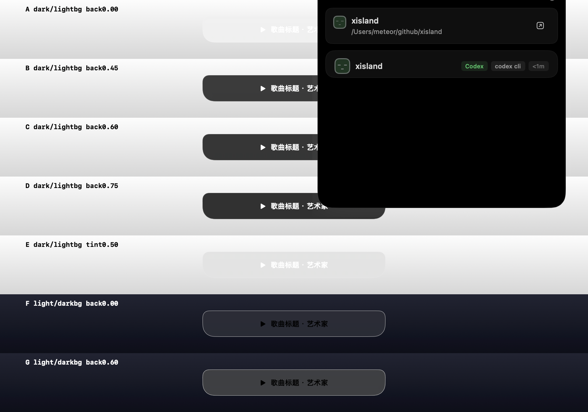
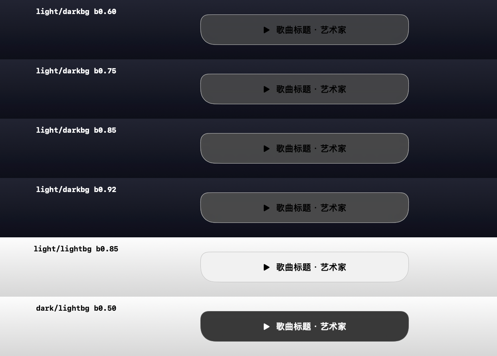
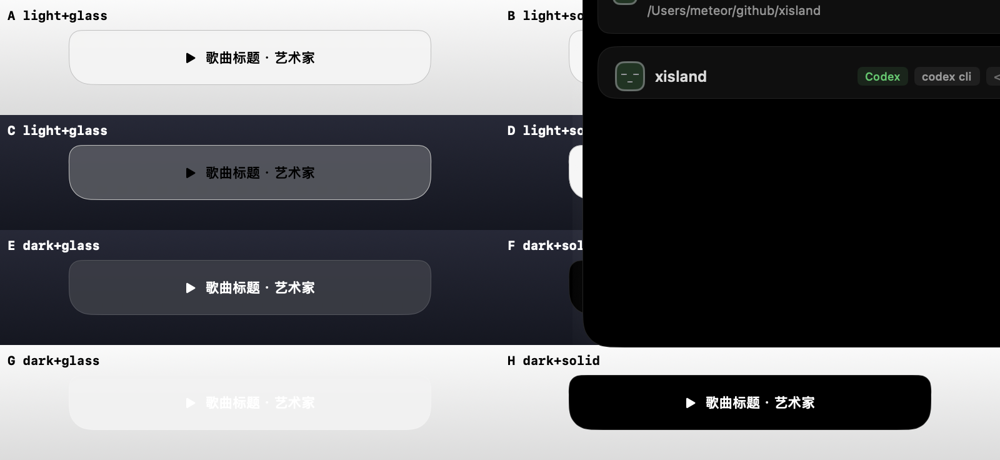

# Liquid Glass 对比度验证记录

验证环境：macOS 26.6.1（Build 25G76），本地屏，缩放系数 2.0。
验证对象：`Sources/XNook/Core/IslandGlassBackground.swift`。

## 结论先行

1. **`.glassEffect` 无法用离屏渲染验证**——离屏路径产出的是伪影，据此判断视觉质量会得出错误结论。
2. **玻璃材质对背景的响应是「压暗」**，这一效应在深浅两种配色下不对称：
   - 深色模式：黑色背衬可把文字对比度从 **1.11:1** 提升到 **8.94:1**
   - 浅色模式：白色背衬即使加到 92%，对比度仍只有 **3.11:1**，达不到 AA
3. 因此玻璃**仅在深色模式启用**，浅色模式回退纯色填充。

## 一、方法论教训：离屏渲染不可信

最初用 `NSHostingView + cacheDisplay` 离屏渲染对比玻璃与纯色，得出
「玻璃面板轮廓消失、与背景糊成一片」的结论。

**该结论错误，已推翻。** 判定依据：探针脚本里背景写的是 `Color(white: 0.12)`
深灰，但离屏渲染输出的图像是全谱高饱和彩虹渐变——背景被完全污染，与脚本
输入不符。

原因：`.glassEffect` 依赖窗口合成器采样「视图背后」的内容，离屏渲染走不到
这条路径，产出的是未定义内容而非真实效果。

### 正确的验证方式

必须开真实窗口 + `screencapture -R` 抓屏。两个坑：

- **坐标原点不同**：`NSWindow` 用左下角原点，`screencapture -R` 用左上角。
  换算：`topOffset = screenH - originY - height`。
- **要用两个窗口**：不透明背景窗口（`level = .normal`）+ 透明玻璃窗口
  （`level = .floating`，`isOpaque = false`）。把背景画在同一个窗口内，
  采样路径与生产环境不一致，结果不可靠。

## 二、对比度实测数据

WCAG 对比度，采样点为面板内文字上方与下方的多点，取**最差值**。

### 深色模式（文字为白色）

| 背景 | 无背衬 | 黑色背衬 0.45 | 0.50 | glassEffect tint 0.50 |
|---|---|---|---|---|
| 浅色 | **1.11:1 FAIL** | 8.62:1 PASS | **8.94:1 PASS** | 1.22:1 FAIL |

### 浅色模式（文字为黑色）

| 背景 | 无背衬 | 白色背衬 0.60 | 0.75 | 0.85 | 0.92 |
|---|---|---|---|---|---|
| 深色 | **1.87:1 FAIL** | 2.62:1 FAIL | 2.82:1 FAIL | 3.01:1 weak | 3.11:1 weak |

### 四种配色 × 背景组合

矩阵第 4 行 `G dark+glass` 是缺陷首次暴露的位置：深色模式（白字）叠加浅色
背景时，玻璃采样到浅背景而渲染成浅色，白字几乎不可见。

## 三、根因：压暗效应的不对称性

玻璃材质会按背景亮度调整自身，且调整方向偏向压暗。这造成：

- **深色模式**：需要面板变暗。黑色背衬顺应压暗方向，很轻松把面板拉到可读区间。
- **浅色模式**：需要面板变亮。白色背衬要对抗压暗，效率极低——即便白色背衬
  加到 92%，面板 RGB 也只到 0.29。

**背衬必须放在玻璃之下**（用 `.background`）。玻璃采样它背后的内容，垫在下面
才能既保住折射质感又压住亮度；放在之上会直接盖掉玻璃效果。

## 四、两条已排除的修复路径

避免重复尝试：

- `.glassEffect(.regular.tint(.black.opacity(0.5)))` → 1.22:1，几乎无改善
- `.environment(\.colorScheme, .dark)` → 对 glass 无效，glass 不读 colorScheme

## 五、实现要点

背衬不透明度集中在 `IslandGlassTuning`：

| 参数 | 值 | 说明 |
|---|---|---|
| `backingCollapsed` | 0.50 | 收起态，实测阈值 0.45，留余量 |
| `backingExpanded` | 0.55 | 展开态，面积大文字多，压得更实 |
| `highlightCollapsed` | 0.05 | 质感高光，取值必须极低 |
| `highlightExpanded` | 0.03 | 同上 |

`Tests/XNookTests/IslandCapabilitiesTests.swift` 锁住 0.45 下限——这是安全
参数而非审美参数，调低会让文字在浅色壁纸上失去对比度。
